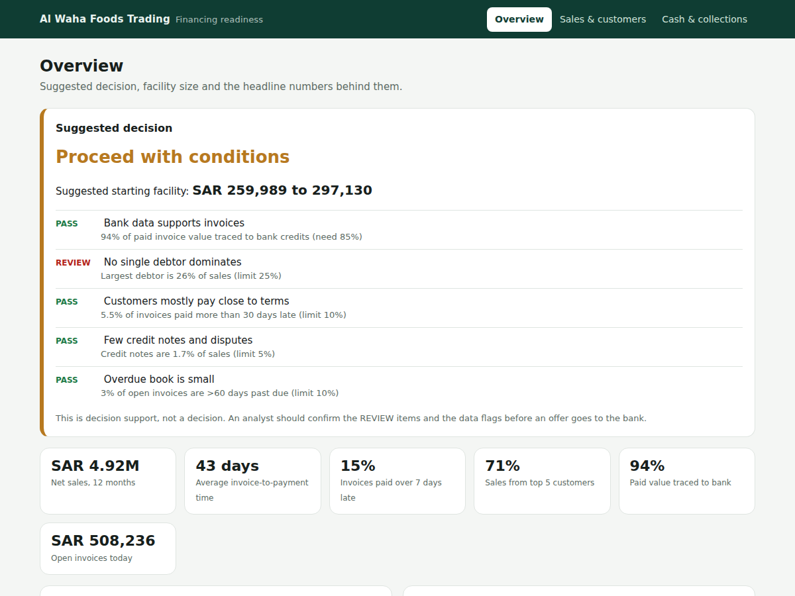
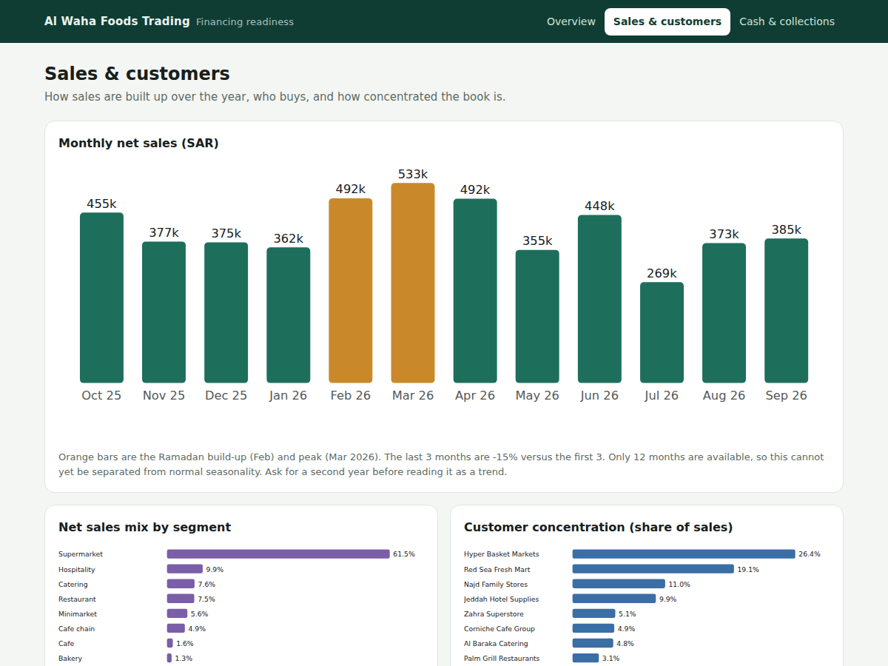

# Financing Readiness Prototype

**Qawafel Graduate Software Engineer assessment, Task 3**

[Open the live dashboard](https://ahmedaljahdali7.github.io/qawafel-financing-prototype/output/dashboard.html)

A small tool that turns a wholesaler's invoices and bank transactions into a short dashboard a credit analyst can use to decide on a receivables-financing request. It gives a **suggested decision**, a **suggested facility size**, and the **reason behind every rule**, so the analyst can check the logic and disagree with it.

> All data is made up. The company ("Al Waha Foods Trading", a Jeddah food wholesaler) and its 20 customers do not exist.



## Result on the sample data

| | |
|---|---|
| Suggested decision | **Proceed with conditions** |
| Suggested starting facility | **SAR 259,989 to 297,130** (70% to 80% of SAR 371,413 eligible receivables) |
| Paid invoices traced to the bank | 94% of value (641 of 680 invoices) |
| Item for the analyst to review | The largest customer is 26% of sales (limit 25%) |
| Bank statement | Balance check passed. 21% of credits are cash deposits that cannot be traced to an invoice |

## Quick start

Requires Python 3.10 or newer (tested on 3.11).

```bash
pip install -r requirements.txt
python analyze.py
```

Then open `output/dashboard.html` in a browser. It works offline. A ready-made copy of the results is already in `output/`.

Keep the three `.html` files in `output/` together, because the menu links to the other pages.

Optional commands:

```bash
python generate_data.py        # recreates the fictional data (seeded, so results repeat exactly)
python analyze.py --invoices my_invoices.csv --bank my_bank.csv --as-of 2026-10-15   # use your own files
python analyze.py --bank sample_data/bank_transactions_missing_row.csv --out /tmp/check   # see the balance check fail
```

Your own files need the same column names as the files in `sample_data/`.

## How it works

```
invoices (CSV/Excel) ─┐
                      ├─► 1 Clean ─► 2 Reconcile ─► 3 Check bank ─► 4 Metrics ─► 5 Decision ─► dashboard + metrics.json
bank transactions ────┘
```

1. **Clean.** Removes duplicate invoices, merges misspelled customer names, fills missing VAT at 15%, fixes impossible dates, and lists everything it changed.
2. **Reconcile.** Matches invoices marked "Paid" to bank credits in four steps: invoice reference, batch reference (one transfer paying several invoices), exact amount and date, and short payment. Whatever is left is shown as untraced.
3. **Check the bank statement.** Opening balance plus credits minus debits must equal every running balance. A missing row or edited line fails the check. Cash deposits are flagged.
4. **Compute metrics.** Monthly sales, days to pay, late-payment rate, customer concentration, receivables ageing, credit-note rate.
5. **Decide.** Five plain rules give the decision. Eligible receivables give the facility range.

### Decision rules

| Rule | Pass when | Sample result |
|---|---|---|
| Bank data supports invoices | At least 85% of paid value traced to the bank | Pass (94%) |
| No single debtor dominates | Largest customer is 25% of sales or less | **Review** (26%) |
| Customers mostly pay close to terms | 10% or less of invoices paid 30+ days late | Pass (5.5%) |
| Few credit notes and disputes | Credit notes are 5% of sales or less | Pass (1.7%) |
| Overdue book is small | 10% or less of open invoices more than 60 days past due | Pass (3%) |

0 reviews = **Proceed**. 1 or 2 = **Proceed with conditions**. 3 or more = **Do not proceed yet**.

### Facility size

Open invoices, minus those more than 60 days past due, minus invoices from customers on "Watch", minus the amount that would put one customer above 25% of the pool, gives the eligible receivables. The facility is 70% to 80% of that. The Overview page shows each step.

## The dashboard

| Page | What it answers |
|---|---|
| **Overview** | What is the decision and why? How was the limit worked out? Do the invoices and the bank agree? What did the cleaning change? |
| **Sales & customers** | How do sales move through the year? Who buys? How concentrated is the book? Which customers pay late? |
| **Cash & collections** | How fast does cash come in? What is overdue? What is faster collection worth? |



## Sample data

| File | Contents |
|---|---|
| `sample_data/invoices.csv`, `invoices.xlsx` | 755 rows (738 invoices, 17 credit notes), Oct 2025 to Sep 2026, as received, with deliberate mistakes |
| `sample_data/bank_transactions.csv` | 821 bank lines with an opening balance of SAR 2,500,000 and a running balance |
| `sample_data/bank_transactions_missing_row.csv` | The same statement with one line removed, to show the balance check failing |
| `sample_data/excel_versions/` | The same data after manual review in Excel, with check formulas. `analyze.py` reaches the same numbers from the raw CSV |

The data is built to look like real life: sales peak around Ramadan 2026, customers have different payment terms (15 to 60 days) and habits, some payments cover several invoices, a few arrive short, and cash deposits appear next to customer transfers.

Mistakes planted in the invoices, which the cleaning step finds:

| Mistake | Count |
|---|---|
| Duplicate rows (exported twice) | 7 |
| Missing VAT | 6 |
| Due date before invoice date | 3 |
| Paid before invoiced | 2 |
| Customer name variants | 10 rows |

The bank data also contains invoices marked paid with no bank credit, and bank credits with no invoice.

## Assumptions

All policy numbers are constants at the top of `analyze.py` and can be changed in one place.

- The 70% to 80% advance rate is my assumption of a typical range, not Qawafel's or a bank's real policy.
- "Late" means paid more than 7 days after the due date. "Watch" means late over 30% of the time and over 10% of the time more than 30 days late.
- VAT is 15%. The weekend is Friday and Saturday.
- The open-invoice position is measured at 15 October 2026 (`--as-of`).
- Bank statements are assumed to be extracted from PDF already. Reading real PDFs is described in the written document (Task 2) and is not built here.
- Sharia compliance of the financing structure (for example, how a fee is charged) is out of scope.

## Limits

- The rules are simple on purpose so an analyst can follow them. This is not a credit model and has not been tested on real data.
- Matching is greedy (the first match wins). Real data needs a smarter matcher and a person to review the untraced items.
- The suggested facility is small next to annual sales (about SAR 5M) because only invoices still open count. That is how receivables financing works, and the analyst should explain it to the customer.
- Twelve months of data cannot separate seasonality from a trend, so the dashboard does not claim either.

## Files

```
analyze.py             cleaning, reconciliation, metrics, decision rules, dashboard
generate_data.py       creates the fictional data
requirements.txt       pandas, numpy, openpyxl
sample_data/           invoices and bank transactions (raw CSV, plus Excel versions)
output/                dashboard.html (open this), sales.html, cash.html, metrics.json
docs/                  screenshots used in this README
```

`output/metrics.json` holds the same numbers as the dashboard in a form other programs can read. It is the small version of the machine-readable file in the bank package described in the written document.
